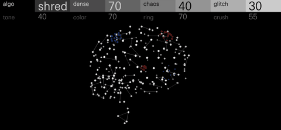
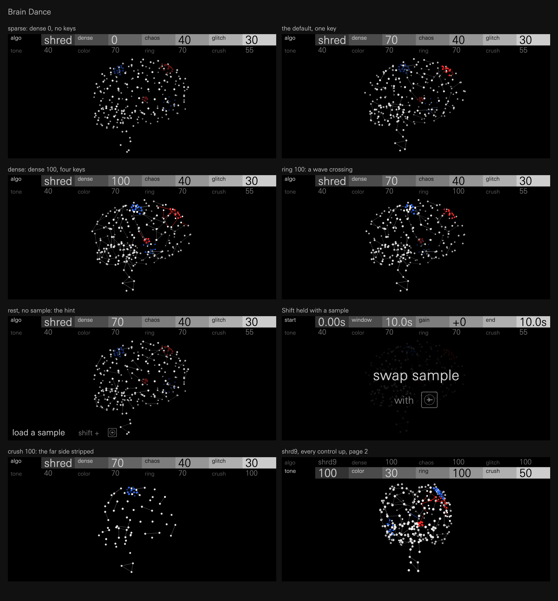

# Brain Dance

A generator of glitch beats for the OP-XY. Hold a key and it plays a pattern on
the project's tempo, tuned to that key; hold more keys and it gets more
complex, each key adding a part with its own cycle. Load a sample and it
builds its kit from it. After Autechre, Aphex Twin and Ryoji Ikeda.



*Shown: the default preset, Shred, from one key to four.*

**Status: experimental.** Brain Dance plays on an OP-XY running OS 1.2.1 and
targets Open-XY SDK 1.17 (the SDK's `staging` branch). Played on the device:
the six algorithms and their variants, the screen, loading a sample and
playing its hits, the Shift row. Checked on the host: its level, that hits
land on the grid, that a key always plays the same. Its CPU cost is measured
on an OP-XY for each release ([CPU](#cpu)). It can't share a
firmware with Timestretch: both use the SDK's sample analysis, and a
firmware's analyses share 2 MiB, all of which Timestretch reserves.

## Playing it

Choose **Brain Dance** on an instrument track and hold a key. It needs no
sample: with none loaded it plays its own synthesis. The pattern follows the
project's tempo, and while the sequencer plays it follows the song position,
so its hits land on the OP-XY's grid; stopped, the first key starts the
pattern. Try 180 BPM.

Each held key is one voice with four lanes, all tuned to the key: **low** (a
bass that sweeps down), **snap** (noise over a body), **click** and **blip**.
The first key is the foundation. Each key after it takes a higher, busier
part with cycles of other lengths, and every key makes all of them denser and
more chaotic.

| Page 1 | | Page 2 | |
| --- | --- | --- | --- |
| **algo** | the pattern: six algorithms, ten variants of each | **tone** | decay, pitch drop, how much of a step sounds |
| **dense** | how many hits | **color** | sine to square to bits; the bass from a sine to a buzz |
| **chaos** | mutation, chops, dropped hits | **ring** | a gated, chopped reverb; past halfway, a comb at the key |
| **glitch** | ratchets, triplet stutters, dropouts | **crush** | drive into a hard clip; past 60%, fewer bits and a lower sample rate |

Press any encoder to switch pages. The OP-XY's own envelopes, LFOs, filter and
effects apply as for any instrument.

### The sixty steps

The first encoder steps through six algorithms, each with ten variants. The
header shows the name, then a short form and the variant: `shred`, `shrd1` to
`shrd9`.

| Algorithm | Variants | What it plays |
| --- | --- | --- |
| **lanes** | lane1–9 | Four lanes, each a euclidean rhythm of its own length (16, 12, 10 and 7 steps), drifting against each other. The variants change the lengths |
| **break** | brk1–9 | A two-bar break read a 16th at a time; chaos jumps the reader or holds it, glitch rolls the snare. The variants are other breaks: a two-step, a half-time, a jungle chop, a 3-3-2, fives |
| **data** | data1–9 | A bar of 32nds from a register, repeated exactly until chaos deals another: pulses, beeps and bit noise under hard gates. The variants change the bar's length and the pulses' periods |
| **eucl** | eucl1–9 | Euclidean wheels; later keys play 12 and 10 against 16. The variants change the wheels and how far each is turned |
| **pulse** | puls1–9 | Four pacemakers on the 16th grid, each setting off the next: interlocking figures that repeat. The variants change their periods and wiring |
| **shred** | shrd1–9 | A bass sweeping down on nearly every 16th, in cycles of six against the bar's eight, resting under bursts of gated noise or landing and holding. The variants change the cycles and the sweeps |

A variant also changes which lanes lead, whether ratchets divide in halves,
thirds or fifths, and whether the click and blip play an octave up.

### Samples

Load a sample with Shift + the Sample key. Brain Dance listens through it once
and keeps the moments it can use: low hits (kicks), noisy hits (snares,
claps), short bright hits (ticks, hats), short pitched hits, held tones and
held noise. Each lane then plays its own kind of hit, tuned by the key: on C
at the hit's own pitch, up to six semitones either way on other keys. Where
it finds no hit for a lane, the lane shapes a held tone or noise from the
sample with its own synthesis; where it finds neither, the lane keeps its
synthesis. Chaos now and then swaps in another hit it found.

It finds moments where one sound dominates, so a sample with separate hits
and held notes gives more than a full mix.

Holding Shift, the encoders edit the stock sampler's markers and gain, and
the header shows them:

| Shift + | Edits |
| --- | --- |
| encoder 1 | **start**: only what lies between start and end is used |
| encoder 2 | **window**: start and end together |
| encoder 3 | **gain**: the sample's level |
| encoder 4 | **end** |

With Shift held the screen dims and reads **swap sample with** and the Sample
key's icon. With no sample, the corner of the screen says how to load one.

## The screen

A cloud of 270 points in the shape of a brain, turning while keys are held.
Links join neighbouring points as the playing gets denser: none at dense 0
with no keys held, all 180 at dense 100 with four. While keys are held, the
red and blue clusters flash, one cluster a key, and each flash sends a wave
out through the cloud. ring sends the wave further, tone grows the points,
chaos turns the brain faster, glitch makes points and links flicker, crush
past 60% strips the far side away, and color tints the resting clusters. At
rest it is still.



Every control at 0, 50 and 100: [docs/controls-1x.png](docs/controls-1x.png)
at the OP-XY's size, [docs/controls.png](docs/controls.png) at twice it.

## Presets

Sixteen, in [docs/presets.md](docs/presets.md). **Shred** is the default.
Six sit on variants: Gate Storm (`shrd4`), Sub Hold (`shrd8`), Comb Teeth
(`shrd2`), Threes (`shrd3`), Long Count (`shrd9`) and Two Step (`brk1`) among
them.

## CPU

Measured on an OP-XY (OS 1.2.1) with the SDK's `profile benchmark`: one voice
plays the SDK's generated two-second test sample at the default settings
(Shred). Each figure is a share of the OP-XY's 580,352-cycle audio block: the
mean over the test, and its worst single block. The screen isn't included.

| Release | One voice | Worst block |
| --- | ---: | ---: |
| v1.0.0 | 2.60% | 5.64% |
| v1.0.1 | 1.98% | 3.78% |

The first key also runs the reverb every key shares, so each further key costs
less than the first.

## Building

Brain Dance is a sample engine on the stock sample page that draws its own
screen. It targets [Open-XY](https://github.com/etcetc000/open-xy) SDK 1.17,
on the SDK's `staging` branch:

```sh
git clone -b staging https://github.com/etcetc000/open-xy ../open-xy
python ../open-xy/sdk.py toolchain fetch
python ../open-xy/sdk.py test --machine . --cxx clang++ --host-cxx g++
python ../open-xy/sdk.py test --machine . --firmware
python ../open-xy/sdk.py build --machine . --stock-os <your stock-1.2.1>/os.ldr \
  --layout <the layout.json read from your OP-XY> --out <folder outside this checkout>
```

Pass the layout read from your OP-XY (`/layout.json`) with `--layout`, so
machines keep their numbers and old projects open the machines they were made
with. Then install the build's `candidate/` files as the SDK's
[build guide](https://github.com/etcetc000/open-xy/blob/staging/docs/build.md#5-install)
describes. Leave Timestretch out of a firmware that holds Brain Dance: the SDK
refuses to build the two together.

## Develop

- `sample.cpp`: the engine, in integer arithmetic. One clock every voice
  shares, the six algorithms and their variants, the four lanes, the shared
  gated reverb, the comb and the clip.
- `harvest.h`: the sample analysis, run by the SDK on the OP-XY's file worker
  when a sample is loaded.
- `display.cpp`: the screen, its artwork in `panel.svg.fragment` and its
  points and links in `brain.h` (`tools/make_panel.py` writes both).
- `sample_view.h`, with its artwork in `tools/sample_view.py`: the Shift
  overlay, shared byte for byte with Grains and the Nonagon Suite's Ghost and
  Recur. Change them only together.
- `tools/make_presets.py` writes `definition.json`, `presets/` and
  `docs/presets.md`.
- `tests/`: the sound (level, the grid, every step of the sixty, and its
  exact output pinned by hash, so work on its speed can't change it), the
  sample analysis on generated samples, and the screen (every frame valid, the
  turn smooth in every algorithm and at every control's ends).
- `tools/render.cpp` renders the engine to a WAV on the host;
  `tools/screens.mjs` renders the screen from the WebAssembly build.
- `web/`: a playable page of the engine and screen in the browser
  (`web/build.sh`, then `web/make_page.py`).
- [QA.md](QA.md): what to check on an OP-XY.

## Licence

MIT. See [LICENSE](LICENSE).
